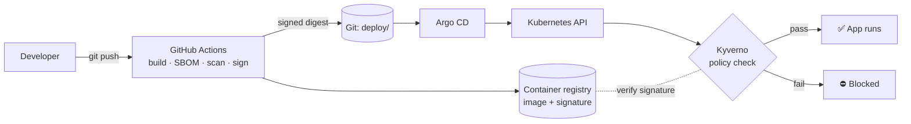

# Policy as Code for Data Protection

Enforcing Kenya's Data Protection Act with Kyverno and Sigstore — a fully open
source demo built for **OpenInfra Days Kenya 2026**.

> **New to Kubernetes, containers or supply-chain security?**
> Read **[How this project works](docs/how-it-works.md)** first. It explains
> every idea and term in plain language, with diagrams, and needs no technical
> background. This README is the hands-on part.

## What this project does, in one paragraph

Instead of checking compliance with a document and an audit every few months,
this project turns data-protection rules into **code that a computer enforces
automatically**. Every time software is deployed, a "security guard"
([Kyverno](https://kyverno.io)) checks it at the door of the Kubernetes
cluster. It checks that the software is **signed by us**, **labelled with what
data it handles**, **not running with dangerous powers**, and **running only
where that data is allowed**. Anything that breaks a rule is refused before it
ever starts.

## The big picture



| Stage | Tool | What it does |
|---|---|---|
| Build | Docker | Packages the demo app into a container image |
| SBOM | [Syft](https://github.com/anchore/syft) | Lists every component inside the image |
| Scan | [Trivy](https://trivy.dev) | Checks those components for known vulnerabilities |
| Sign | [Cosign](https://github.com/sigstore/cosign) (Sigstore) | Seals the image with our private key |
| Enforce | [Kyverno](https://kyverno.io) | Checks the policies at deploy time and blocks anything that breaks a rule |
| Automate | GitHub Actions + [Argo CD](https://argo-cd.readthedocs.io) | Builds and signs on every push, then deploys what's in Git |

Every tool is open source. For how each policy maps to a DPA obligation, see
[`docs/dpa-control-mapping.md`](docs/dpa-control-mapping.md).

---

## Running it end to end

The walkthrough is split into **six parts**. Each step tells you **what's
happening**, the **command** to run, and **what you should see**. Do them in
order, all in the same terminal.

| Part | What you'll do | Time |
|---|---|---|
| [1. Prepare your machine](#part-1--prepare-your-machine) | Install the tools | ~10 min |
| [2. Build the cluster and its guard](#part-2--build-the-cluster-and-its-guard) | Create a local Kubernetes cluster, install Kyverno, create a signing key | ~10 min |
| [3. Build, check and sign the app](#part-3--build-check-and-sign-the-app) | Build the image, generate the SBOM, scan, push, sign | ~5 min |
| [4. Try to break the rules](#part-4--try-to-break-the-rules) | Deploy good and bad apps and watch Kyverno decide | ~2 min |
| [5. Automate everything](#part-5--automate-everything-github-actions--argo-cd) | GitHub Actions + Argo CD (GitOps) | ~20 min |
| [6. Clean up](#part-6--clean-up) | Delete the cluster | 1 min |

### What you need before you start

- [ ] A **Linux** machine (or WSL2 / macOS, adjusting the download links) with **at least 2 GB of free RAM**, or 3 GB for Part 5
- [ ] **Docker** installed and usable *without* `sudo`. Test with `docker ps`.
  If you get a permission error, run `sudo usermod -aG docker $USER`, then log
  out and back in.
- [ ] `kubectl`, `helm` and `python3` installed
- [ ] A **GitHub account**

> ⚠️ **Never run these scripts with `sudo`.** Run everything as your normal
> user. The scripts refuse to run as root.

---

## Part 1 — Prepare your machine

### Step 1.1 · Install the tools

**What's happening:** you're downloading four command-line tools: `kind`
(creates a practice cluster), `cosign` (signs images), `syft` (makes the
ingredients list) and `trivy` (scans for vulnerabilities). They go into
`~/.local/bin`, so no admin rights are needed.

```bash
mkdir -p ~/.local/bin
curl -Lo ~/.local/bin/kind   https://github.com/kubernetes-sigs/kind/releases/download/v0.29.0/kind-linux-amd64
curl -Lo ~/.local/bin/cosign https://github.com/sigstore/cosign/releases/download/v2.5.3/cosign-linux-amd64
curl -sSfL https://raw.githubusercontent.com/anchore/syft/main/install.sh | sh -s -- -b ~/.local/bin
curl -sSfL https://raw.githubusercontent.com/aquasecurity/trivy/main/contrib/install.sh | sh -s -- -b ~/.local/bin
chmod +x ~/.local/bin/*
export PATH=~/.local/bin:$PATH
echo 'export PATH=~/.local/bin:$PATH' >> ~/.bashrc
```

**You should see:** each tool print its version when you run:

```bash
kind version && cosign version && syft version && trivy --version
```

If one fails, rerun its download line. A download that was interrupted leaves
a broken file behind.

### Step 1.2 · Get the project

```bash
git clone https://github.com/<owner>/policy-as-code-dpa.git   # or use your existing copy
cd policy-as-code-dpa
```

---

## Part 2 — Build the cluster and its guard

### Step 2.1 · Create the cluster and install Kyverno

**What's happening:** `kind` creates a one-node Kubernetes cluster inside
Docker on your machine. Helm then installs **Kyverno** (the guard) and the
optional **Policy Reporter** web UI. Finally, the policies, our rulebook, are
loaded.

```bash
./cluster/bootstrap.sh
```

Short on memory? Run `INSTALL_POLICY_REPORTER=false ./cluster/bootstrap.sh`
to skip the UI.

**You should see:** the script ends with `Cluster is ready.` On this first run
it also prints `SKIPPING require-signed-images: no Cosign public key yet`.
That's expected, and the next step fixes it. To check:

```bash
kubectl get pods -n kyverno     # every pod STATUS = Running
kubectl get clusterpolicy       # 3 policies, READY = True
```

### Step 2.2 · Create your signing key

**What's happening:** Cosign creates a **key pair**:

- `cosign.key` is **private**. It creates signatures. Keep it secret; it's
  git-ignored and password-protected.
- `cosign.pub` is **public**. It checks signatures.

The script also writes the public key into the signing policy and loads that
policy into the cluster. From now on, Kyverno only trusts images signed with
*your* key.

```bash
./scripts/generate-cosign-key.sh
```

You'll be asked for a password. **Remember it.** You'll need it in Part 3 and
Part 5.

**You should see:** `cosign.key and cosign.pub are ready`, and now all four
policies are ready:

```bash
kubectl get clusterpolicy       # 4 policies, READY = True
```

---

## Part 3 — Build, check and sign the app

### Step 3.1 · Log in to the container registry

**What's happening:** the image has to be stored somewhere the cluster can
download it from. We use GitHub's registry, `ghcr.io`. Logging in lets Docker
upload to it.

You need a GitHub **personal access token (classic)** with the
**`write:packages`** scope. Create one at GitHub → Settings → Developer
settings → Personal access tokens → **Tokens (classic)**. Fine-grained tokens
don't work for this.

```bash
export GH_USER=<your-github-username>          # lower-case
echo <your-token> | docker login ghcr.io -u "$GH_USER" --password-stdin
export IMAGE_REPO=ghcr.io/$GH_USER/policy-as-code-dpa-app
```

**You should see:** `Login Succeeded`.

> Keep this terminal open. `IMAGE_REPO` only exists in this terminal session,
> and the next steps need it. In a new terminal, run the `export` lines again.

### Step 3.2 · Build, generate the SBOM, scan, push and sign

**What's happening:** one script runs the whole factory line:

1. **Builds** two images of the demo app: `:signed` and `:unsigned`. They get
   different fingerprints, so we can prove an unsigned image gets blocked.
2. **Generates the SBOM** with Syft and saves it to `docs/sbom.spdx.json`.
3. **Scans** with Trivy and saves the report to `docs/trivy-report.txt`.
4. **Pushes** both images to `ghcr.io`.
5. **Signs only `:signed`** with your private key. It asks for your password.
6. **Double-checks** that `:signed` verifies and `:unsigned` doesn't.

```bash
./scripts/sign-and-scan.sh
```

**You should see:** a long Trivy table, which is normal (see the note below),
then `Done.` followed by:

```
  ghcr.io/<you>/policy-as-code-dpa-app:signed   built, scanned, SBOM'd and signed
  ghcr.io/<you>/policy-as-code-dpa-app:unsigned built and pushed, intentionally unsigned
```

> **About the Trivy findings:** they come from the operating-system packages
> in the `python:3.12-slim` base image, not from the app. By default they're
> reported without stopping the run. Set `FAIL_ON_VULNS=1` to block the build
> on HIGH/CRITICAL findings.

### Step 3.3 · Make the image public

**What's happening:** the cluster (and Kyverno, when it checks the signature)
downloads the image anonymously. New GitHub packages start out private, so
they'd get "access denied".

On GitHub: your profile → **Packages** → `policy-as-code-dpa-app` →
**Package settings** → **Danger Zone** → **Change visibility** → **Public**.

**You should see:** `200` from this check (`403` means it's still private):

```bash
TOKEN=$(curl -s "https://ghcr.io/token?scope=repository:$GH_USER/policy-as-code-dpa-app:pull&service=ghcr.io" | python3 -c 'import sys,json;print(json.load(sys.stdin)["token"])')
curl -s -o /dev/null -w '%{http_code}\n' -H "Authorization: Bearer $TOKEN" \
  -H 'Accept: application/vnd.oci.image.manifest.v1+json, application/vnd.docker.distribution.manifest.v2+json' \
  https://ghcr.io/v2/$GH_USER/policy-as-code-dpa-app/manifests/signed
```

---

## Part 4 — Try to break the rules

This is the demo itself. Six apps try to get into the cluster. Two follow
every rule. Four each break exactly one.

### Step 4.1 · Run the automatic check

**What's happening:** the script creates two namespaces. `demo-fintech` is
approved for sensitive data; `demo-sandbox` isn't. The script then tries to
deploy all six apps and checks that each one is admitted or blocked **by the
right rule**.

```bash
./scripts/verify-demo.sh
```

**You should see:** a `PASS` for every line, ending with:

```
Result: 11 passed, 0 failed
```

### Step 4.2 · (Optional) Do it by hand, e.g. on stage

**What's happening:** this is the same thing, one app at a time, so an
audience can watch each decision. First, point the files at your image:

```bash
sed -i "s|ghcr.io/REPLACE_ORG/policy-as-code-dpa-app|$IMAGE_REPO|g" \
  manifests/compliant/*.yaml manifests/non-compliant/*.yaml

kubectl delete -f manifests/namespace.yaml --ignore-not-found   # start clean
kubectl apply -f manifests/namespace.yaml
```

Then deploy them one at a time:

| Command | Expected | Why |
|---|---|---|
| `kubectl apply -f manifests/compliant/pod.yaml` | ✅ created | Signed, labelled, non-root |
| `kubectl apply -f manifests/compliant/pod-restricted-data.yaml` | ✅ created | Restricted data, but `demo-fintech` is approved |
| `kubectl apply -f manifests/non-compliant/pod-unsigned-image.yaml` | ⛔ blocked | `require-signed-images`: no valid signature |
| `kubectl apply -f manifests/non-compliant/pod-missing-labels.yaml` | ⛔ blocked | `require-data-classification-labels`: no labels |
| `kubectl apply -f manifests/non-compliant/pod-privileged-root.yaml` | ⛔ blocked | `restrict-privileged-workloads`: root and privileged |
| `kubectl apply -f manifests/non-compliant/pod-restricted-unapproved-namespace.yaml` | ⛔ blocked | `restrict-to-approved-namespaces`: `demo-sandbox` isn't approved |

A blocked app shows Kyverno's reason:

```
Error from server: admission webhook "..." denied the request:
resource Pod/demo-fintech/unsigned-app was blocked due to the following policies
require-signed-images: ...
```

### Step 4.3 · Look at the evidence

```bash
kubectl get pods -n demo-fintech                      # the two compliant apps are Running
# Kyverno replaced the image tag with the exact fingerprint it verified (@sha256:…)
kubectl get pod compliant-app -n demo-fintech -o jsonpath='{.spec.containers[0].image}'; echo
kubectl get policyreport -A                           # pass/fail record per app
```

Policy Reporter web UI (if installed):

```bash
kubectl port-forward -n kyverno svc/policy-reporter-ui 8082:8080   # open http://localhost:8082
```

---

## Part 5 — Automate everything (GitHub Actions + Argo CD)

So far you've run each step by hand. In real life, robots do it:

- **GitHub Actions**, the factory, runs on every `git push`. It checks the
  manifests against the policies, then builds, generates the SBOM, scans,
  signs, and writes the new image fingerprint into `deploy/` in Git.
- **Argo CD**, the manager, keeps the cluster matching what's in `deploy/`.
- **Kyverno**, the guard, still checks everything Argo CD deploys.

| File | Role |
|---|---|
| [`.github/workflows/build-scan-sign.yaml`](.github/workflows/build-scan-sign.yaml) | The CI pipeline |
| [`deploy/`](deploy/) | What Argo CD deploys: a hardened Deployment + Service pinned to a signed fingerprint |
| [`argocd/install.sh`](argocd/install.sh), [`argocd/application.yaml`](argocd/application.yaml) | Installs Argo CD and points it at `deploy/` |

### Step 5.1 · Put the project on GitHub

**What's happening:** GitHub Actions and Argo CD both work from a Git
repository, so the code has to live on GitHub.

```bash
git init -b main
git add .
git status        # ⚠️ make sure cosign.key is NOT listed (it's in .gitignore)
git commit -m "Policy as code for data protection demo"
```

Create an **empty public** repository called `policy-as-code-dpa` on
github.com (no README, no licence), then:

```bash
git remote add origin https://github.com/$GH_USER/policy-as-code-dpa.git
git push -u origin main
```

`cosign.pub` *is* committed on purpose. It's public, and CI uses it to check
signatures.

### Step 5.2 · Give the robot what it needs

**What's happening:** the CI robot needs your private key to sign, permission
to write back to the repo, and permission to push to the image package.

In your GitHub repo → **Settings**:

1. **Secrets and variables → Actions → New repository secret.** Add two:
   - `COSIGN_PRIVATE_KEY`: paste the full output of `cat cosign.key`
   - `COSIGN_PASSWORD`: the password from Step 2.2
2. **Actions → General → Workflow permissions:** choose **Read and write
   permissions** → Save.
3. Link the image package to the repo: GitHub → your profile → **Packages** →
   `policy-as-code-dpa-app` → **Package settings** → **Manage Actions
   access** → **Add repository** → `policy-as-code-dpa` → role **Write**.

(Optional) To fail builds on serious vulnerabilities, add a repository
**variable** `FAIL_ON_VULNS` = `1`.

### Step 5.3 · Install Argo CD

**What's happening:** first a "dry run" asks Kyverno whether it *would* allow
the GitOps manifests, without creating anything. Then Argo CD is installed and
told to watch your repo's `deploy/` folder.

```bash
# Dry run: the first should succeed, the second should be blocked by require-signed-images
kubectl kustomize deploy | kubectl apply --dry-run=server -f -
kubectl kustomize deploy | sed 's|policy-as-code-dpa-app@sha256:[0-9a-f]*|policy-as-code-dpa-app:unsigned|' \
  | kubectl apply --dry-run=server -f -

export REPO_URL=https://github.com/$GH_USER/policy-as-code-dpa.git
./argocd/install.sh
```

**You should see:** `sync=Synced health=Healthy`, then the Argo CD login
details. To check:

```bash
kubectl get application -n argocd                       # SYNC STATUS Synced, HEALTH Healthy
kubectl get deploy,pods -n demo-fintech -l app=dpa-app  # dpa-app Running
kubectl port-forward svc/argocd-server -n argocd 8443:443
# open https://localhost:8443 (accept the browser warning), user: admin, password: printed by the script
```

### Step 5.4 · Watch the full loop

**What's happening:** you change the app and push. Then the robots take over.

```bash
sed -i 's/demo app/demo app v2/' pipeline/app.py
git commit -am "app: v2" && git push
```

1. On GitHub, open the **Actions** tab. `build-scan-sign` runs: first the
   **policy check**, then **build → SBOM → scan → push → sign → verify**.
   Finally it commits `deploy: ghcr.io/…@sha256:…` to the repo.
2. Argo CD notices the new commit (it checks about every 3 minutes, or click
   **Refresh** in the UI) and rolls out the new version.
3. Kyverno checks the new image's signature before the new pod is allowed to
   start.

**You should see:** a green workflow run, a new `deploy:` commit, and in the
Argo CD UI the app syncing to the new fingerprint. Supply-chain evidence (the
SBOM and Trivy report) is attached to each workflow run under **Artifacts**.

### Step 5.5 · (Optional) Show GitOps can't bypass the guard

**What's happening:** you deliberately point `deploy/` at the **unsigned**
image and push, as if someone tried to sneak it in through Git.

```bash
git pull
yq -i '.images[0].newTag = "unsigned" | del(.images[0].digest)' deploy/kustomization.yaml   # or edit the file by hand
git commit -am "demo: try to deploy an unsigned image" && git push
```

**You should see:** Argo CD's sync **fails** with Kyverno's
`require-signed-images` message, while the signed version keeps running.
Undo it with `git revert HEAD && git push`.

---

## Part 6 — Clean up

```bash
kind delete cluster --name policy-as-code-dpa
```

This deletes the whole local cluster. Your images stay on `ghcr.io` and your
code stays on GitHub.

---

## Presenting this live (suggested running order)

1. **The problem** (2 min): compliance as a quarterly checklist vs. software
   that changes daily.
2. **The idea** (2 min): the security-guard analogy from
   [How this project works](docs/how-it-works.md).
3. **Build and sign** (3 min): show `sign-and-scan.sh` output, the SBOM and
   the Trivy report.
4. **The money shot** (5 min): Step 4.2 by hand. One ✅, then each ⛔ with its
   reason.
5. **Automation** (5 min): push a change, show the Actions run, then Argo CD
   syncing.
6. **GitOps can't bypass it** (2 min): Step 5.5.
7. **Evidence and limits** (2 min): policy reports, Git history, and what this
   doesn't cover.

Run everything once before the talk, and keep the cluster up. Creating it live
takes several minutes.

---

## Troubleshooting

| Symptom | Likely cause and fix |
|---|---|
| `Permission denied` when a script calls `kind` or `cosign` | The binary isn't executable: `chmod +x ~/.local/bin/*` |
| `ERROR: do not run this with sudo` | Run as your normal user. Make sure `docker ps` works without sudo. |
| `kind create cluster` fails with "node(s) already exist" | A half-created cluster is left over: `kind delete cluster --name policy-as-code-dpa`, then rerun Step 2.1 |
| `ERROR: Set IMAGE_REPO` | You're in a new terminal. Rerun the `export` lines from Step 3.1. |
| Push fails: `The token provided does not match expected scopes` | The token lacks `write:packages`, or it's fine-grained. Create a **classic** token (Step 3.1). |
| `verify-demo.sh` says *"Kyverno could not access the registry"* / `UNAUTHORIZED` | The package is still private. Do Step 3.3. |
| A compliant pod is rejected with "no matching signatures" | The image was signed with a different key from the one in the policy. Rerun Step 2.2 (it reuses your key), then Step 3.2. |
| `require-signed-images` missing from `kubectl get clusterpolicy` | Run `kubectl apply -f policies/require-signed-images.yaml` |
| Pod admitted but `ImagePullBackOff` | The package is private, or `IMAGE_REPO` doesn't match what you pushed |
| CI fails at **Push** with `permission_denied` | The package isn't linked to the repo. See Step 5.2, item 3. |
| CI fails at **Promote signed digest** with a 403 | Workflow permissions are read-only. See Step 5.2, item 2. |
| CI fails at **Verify signature** | The `COSIGN_PRIVATE_KEY` secret doesn't match the key in the policy. Paste the contents of the same `cosign.key`. |
| Argo CD app `OutOfSync` with a Kyverno error | Working as intended: the image in `deploy/` isn't signed with your key |
| Argo CD can't fetch the repo | The repo is private. Make it public, or add it under Argo CD → Settings → Repositories. |
| Pods `Pending` or `OOMKilled` | Not enough memory. Use `INSTALL_POLICY_REPORTER=false` and close other containers. |

## Repo layout

```
cluster/      kind cluster config + bootstrap script (installs Kyverno + policies)
policies/     Kyverno policies, one per control (the "rulebook")
pipeline/     Sample app + Dockerfile
scripts/      Key generation, build/scan/sign pipeline, end-to-end verification
manifests/    Demo namespaces + compliant and non-compliant pods (Part 4)
deploy/       GitOps manifests that Argo CD syncs (Part 5)
argocd/       Argo CD install script + Application
docs/         Plain-language guide, DPA control mapping, generated SBOM/scan reports
.github/      CI workflow: policy check, build, SBOM, scan, sign, promote digest
```

## Before you reuse this

- Set `IMAGE_REPO` and `REPO_URL` to your own. The first CI run rewrites
  `deploy/kustomization.yaml` to point at your image. Until then it points at
  the original author's signed image, which your key won't verify.
- Generate your own Cosign key (Step 2.2). Never reuse someone else's.
- [`docs/dpa-control-mapping.md`](docs/dpa-control-mapping.md) is an
  engineering interpretation, not legal advice. Have your compliance team
  review it.
- Policies are set to `Enforce`. While experimenting, switch a rule's
  `failureAction` to `Audit` so you don't lock yourself out.

## License

Apache 2.0 — see [LICENSE](LICENSE). Reuse the policies freely.
