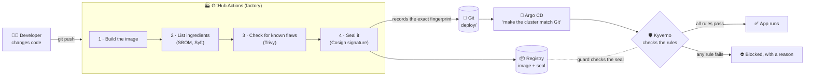
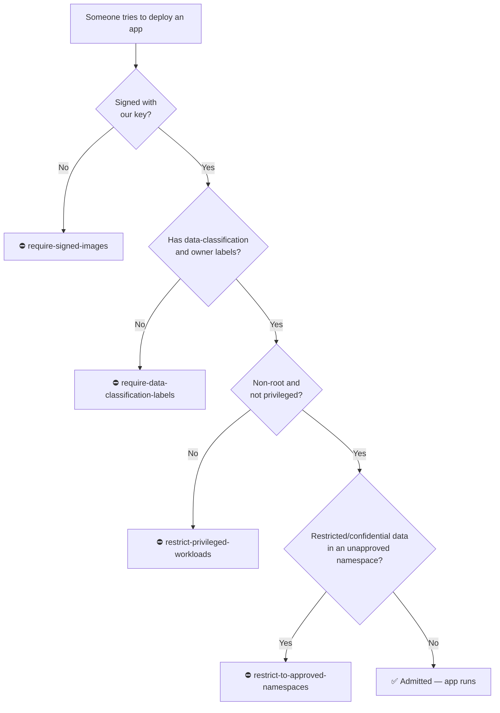

# How This Project Works — A Plain-Language Guide

This guide is for anyone who wants to understand **what this project does and
why**, without needing a Kubernetes or security background. No commands here.
When you're ready to run it, go to the [README](../README.md).

---

## 1. The problem

Kenya's **Data Protection Act (2019)** requires organisations that handle
personal data (names, ID numbers, M-Pesa transactions, medical records) to
protect it with *"appropriate technical and organisational measures"*.

In most organisations, "proving" this looks like:

- a policy document in a shared drive,
- a checklist someone fills in before going live,
- an audit every few months that asks, *"were we compliant last quarter?"*

The trouble is that software changes **many times a day**. A checklist from
three months ago says nothing about what is running right now. By the time an
audit finds a problem, the data may already have leaked.

## 2. The big idea: policy as code

Instead of writing rules in a document and hoping people follow them, we write
the rules **as code**. A computer enforces them automatically, every single
time, at the moment something is deployed.

> **An analogy.** Think of an office building.
>
> - The *old way* is an auditor who reviews the CCTV footage once a quarter
>   to see whether anyone walked in without a badge.
> - *Policy as code* is a guard at the door who checks every badge, every
>   time, and simply doesn't let you in without one.
>
> This project builds that guard for software.

## 3. Words you'll hear (in plain English)

| Term | What it means | Everyday comparison |
|---|---|---|
| **App / container image** | The packaged software, with everything it needs to run, in one bundle | A sealed box from a factory |
| **Registry** (here: `ghcr.io`) | An online store where images are kept | A warehouse |
| **Kubernetes / cluster** | The system that runs apps across computers and restarts them if they crash | The building where the work happens |
| **kind** | A small practice Kubernetes cluster that runs on one laptop | A model of the building |
| **Pod** | One running copy of an app inside Kubernetes | A worker at a desk |
| **Namespace** | A separate section of the cluster, e.g. `demo-fintech` | A floor of the building |
| **Label** | A tag stuck on an app, e.g. `data-classification: restricted` | A name badge |
| **SBOM** (Software Bill of Materials) | A full list of every component inside the image | The ingredients list on food packaging |
| **Vulnerability scan** (Trivy) | Checks those components against public lists of known security flaws | A product-recall check |
| **Digital signature** (Cosign) | A tamper-proof seal added by whoever built the image | A wax seal or a tamper-evident sticker |
| **Private / public key** | The private key creates the seal and stays secret; the public key checks it and can be shared | A stamp you keep locked away, and a photo of the stamp that anyone can compare against |
| **Digest** (`sha256:…`) | A unique fingerprint of the exact image. Change one byte and the fingerprint changes | A fingerprint |
| **Kyverno** | Sits at the cluster's front door and checks every app against our rules before it may run | The security guard |
| **Policy** | One rule the guard enforces, e.g. "images must be signed" | A line in the guard's rulebook |
| **GitHub Actions** (CI) | A robot that builds, checks and signs the app every time someone changes the code | The factory production line |
| **Argo CD** (GitOps) | A robot that keeps the cluster matching what's written in Git | A manager who makes the office match the official floor plan |

## 4. The journey of one app

Here's what happens to the demo app, from a developer's laptop to running in
the cluster.



Step by step:

1. **Build.** The developer's code is packaged into an image, the "sealed box".
2. **List the ingredients (SBOM).** Syft writes down every component inside.
   If a flaw is announced next year in some library, we can find out in seconds
   whether we use it.
3. **Check for known flaws (Trivy).** Every component is checked against public
   vulnerability databases, and the findings are saved as a report.
4. **Seal it (Cosign).** The image is signed with *our* private key. The seal
   is tied to the image's exact fingerprint, so any tampering breaks it.
5. **Store it.** The image and its seal go to the registry.
6. **Record what should run.** CI writes the image's exact fingerprint into Git
   (`deploy/`). Git becomes the single, auditable record of what's in
   production.
7. **Deploy (Argo CD).** Argo CD sees the change in Git and asks the cluster to
   run it.
8. **The guard checks (Kyverno).** Before anything runs, Kyverno checks it
   against every rule. If it passes, it runs. If it fails, it's **refused at the
   door**, with a message explaining why.

Step 8 is the heart of the project. It doesn't matter *who* deploys or *how*
(a person typing commands, a robot, someone in a hurry at 2 a.m.). Everything
goes through the same guard.

## 5. The four rules

These are the rules the guard enforces. Each one maps to a principle in the
Data Protection Act.

| Rule (policy file) | In plain words | What could go wrong without it | DPA principle |
|---|---|---|---|
| **Require signed images**<br/>`require-signed-images.yaml` | Only run software that carries *our* seal | Someone swaps in a tampered or malicious image, e.g. after a registry breach | Integrity & confidentiality |
| **Require data-classification labels**<br/>`require-data-classification-labels.yaml` | Every app must say what kind of data it handles (`public`, `internal`, `confidential`, `restricted`) and who owns it | Nobody knows which systems hold personal data or who is responsible when something leaks | Accountability, data minimisation |
| **Restrict privileged workloads**<br/>`restrict-privileged-workloads.yaml` | Apps may not run as the all-powerful "root" user or with special system powers | One hacked app takes over the whole machine and every other app's data | Security of processing |
| **Restrict to approved namespaces**<br/>`restrict-to-approved-namespaces.yaml` | Apps handling `restricted` or `confidential` data may only run in sections approved for it | Sensitive data ends up in a test area with weaker controls | Storage limitation / data residency |

For a more formal version of this mapping, see
[`dpa-control-mapping.md`](dpa-control-mapping.md).

## 6. What you'll see in the demo

The demo tries to deploy six apps. Two follow every rule. Four each break
exactly one rule.



(Kyverno actually checks all the rules together, but drawing them in order
makes the logic easier to follow.)

| Demo app | What's special about it | Result | Why |
|---|---|---|---|
| `compliant-app` | Signed, labelled, non-root | ✅ Runs | Follows every rule |
| `restricted-data-app` in `demo-fintech` | Handles **restricted** data | ✅ Runs | `demo-fintech` is approved for restricted data |
| `unsigned-app` | Image has **no seal** | ⛔ Blocked | Breaks *require signed images* |
| `unlabelled-app` | **No labels** | ⛔ Blocked | Breaks *require data-classification labels* |
| `privileged-app` | Runs as **root**, privileged | ⛔ Blocked | Breaks *restrict privileged workloads* |
| `restricted-data-app` in `demo-sandbox` | Restricted data in an **unapproved** area | ⛔ Blocked | Breaks *restrict to approved namespaces* |

When something is blocked, you see a message like this, straight from the guard:

```
resource Pod/demo-fintech/unsigned-app was blocked due to the following policies

require-signed-images:
  check-image-signature: 'failed to verify image ...: no matching signatures'
```

Nothing was deployed and then cleaned up later. It **never started**.

## 7. Where's the evidence?

Auditors want proof, not promises. Every run leaves a record:

| Evidence | Where to find it | What it proves |
|---|---|---|
| **SBOM** | `docs/sbom.spdx.json`, CI build artifacts, and attached to the image itself | Exactly what's inside each release |
| **Vulnerability report** | `docs/trivy-report.txt` and CI build artifacts | Known flaws were checked before release |
| **Signature** | Stored next to the image in the registry | The image came from us and hasn't been changed |
| **Git history** | Commits in `deploy/` | What ran in production, when, and who changed it |
| **Policy reports** | `kubectl get policyreport -A`, or the Policy Reporter web UI | Which apps passed or failed which rules |

## 8. Why we sign with our own key (data sovereignty)

Cosign can also sign "keyless", using a free public service run by the
Sigstore project. That service is convenient, but it records signing events in
a public log hosted outside Kenya.

This project signs with a **key pair we generate and keep ourselves**, and it
doesn't publish anything to the public log. Signature data stays inside our own
infrastructure, which matters for organisations with strict data-residency
requirements.

## 9. What this project does *not* do

Being honest about limits matters, especially when talking about compliance:

- **It isn't legal compliance on its own.** The DPA also covers consent, data
  subject rights, breach notification, contracts and more. This project covers
  part of the *technical* side.
- **It doesn't encrypt or protect the data itself.** It controls *which
  software* may run and *how*. Encryption, access control and backups are
  still needed.
- **A clean scan isn't a guarantee.** Trivy only finds *known* flaws. In the
  demo the report is informational. You can make high-severity findings block
  the build.
- **The guard only protects what it watches.** These rules apply to the
  `demo-*` namespaces, and the namespace rule applies cluster-wide. A real
  setup decides carefully which namespaces are in scope.
- **The mapping to the DPA is an engineering interpretation**, not legal
  advice. Have your legal or compliance team review it.

## 10. Common questions

**Can a developer just skip the rules when they're in a hurry?**
No. The rules live in the cluster, not on anyone's laptop. Every deployment,
by a person or by Argo CD, goes through Kyverno.

**What if someone steals an image from the registry and modifies it?**
The fingerprint changes, the seal no longer matches, and Kyverno blocks it.

**What if someone steals the private key?**
They could sign malicious images. That's why `cosign.key` is never committed to
Git, is protected with a password, and is stored only as an encrypted GitHub
secret. If it leaks, generate a new key pair and update the policy.

**Why does the demo make an "unsigned" image at all?**
To prove the guard works. A security control you've never seen *fail* safely
is one you can't fully trust.

**Do I need to be a Kubernetes expert to use this?**
To *understand* it, no. That's what this guide is for. To *run* it, follow the
[README](../README.md) step by step. Every step says what it does and what you
should see.

**Is everything really open source?**
All the tools that build, check, sign, enforce and deploy are open source:
Kubernetes, kind, Kyverno, Cosign/Sigstore, Syft, Trivy and Argo CD. This repo
is Apache-2.0 licensed. GitHub and GitHub Actions are hosted services, not
open source, but the same pipeline steps work in any CI system, such as
GitLab CI, Jenkins, Tekton or Forgejo Actions.

---

**Next:** [run it yourself → README](../README.md)
